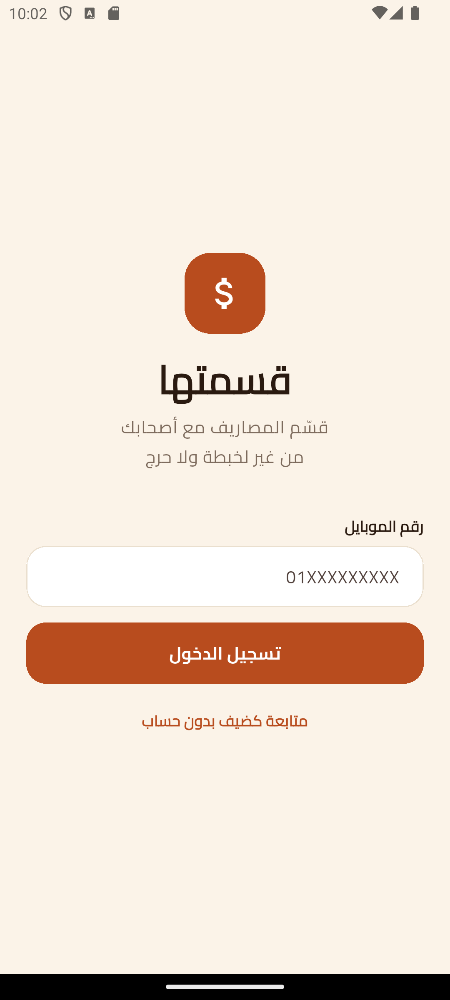
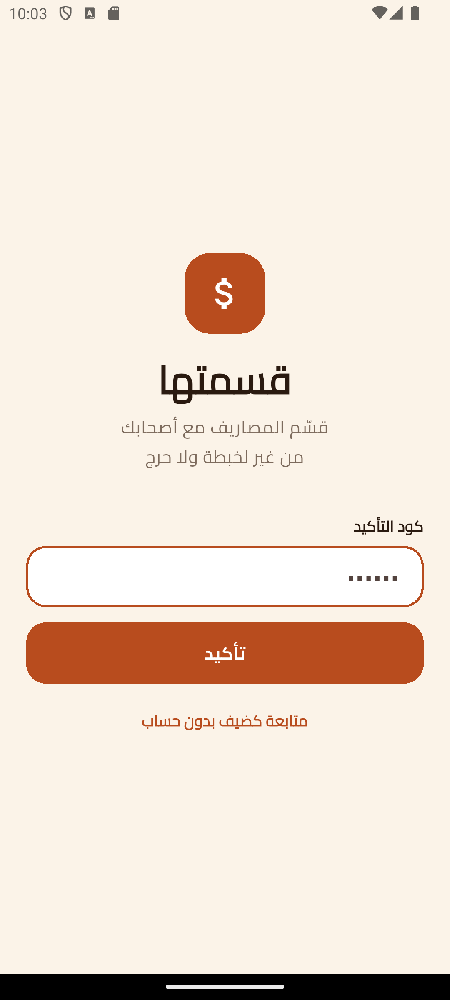
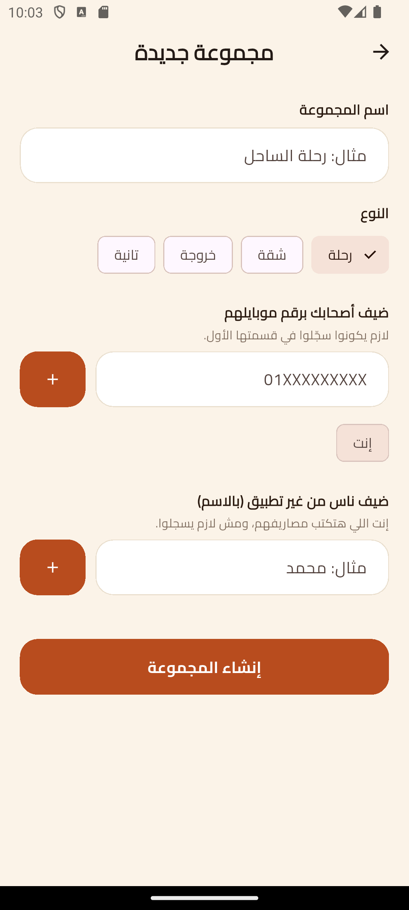
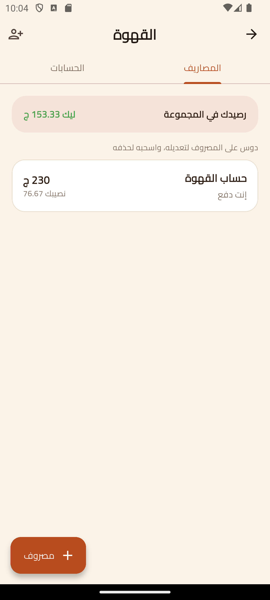
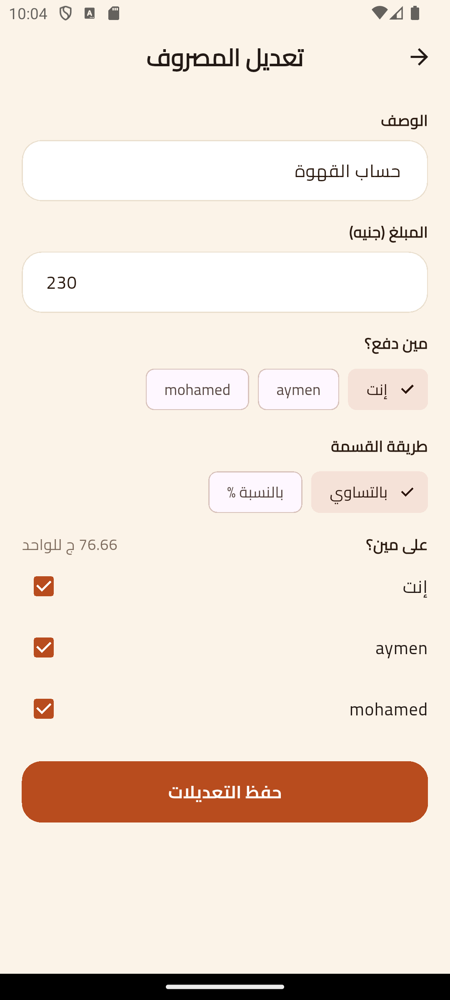
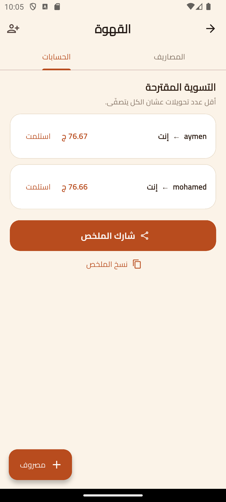

# Qasamtaha (قسمتها)

A Flutter app for splitting shared expenses with friends — trips, flats, outings — with no awkward maths. Add what each person paid, and the app works out who owes whom with the fewest possible transfers.

The interface is Arabic (RTL), built for Egyptian users, with Vodafone Cash and InstaPay shown when paying someone back.

## Screenshots

| Login | Verification code | My groups |
|:---:|:---:|:---:|
|  |  |  |

| New group | Expenses | Edit expense | Balances & share |
|:---:|:---:|:---:|:---:|
|  |  |  |  |

## Features

- **Phone sign-in** with an SMS verification code (Firebase Auth), or continue as a guest.
- **Groups** by type: trip, flat, outing, other.
- **Add friends two ways**
  - by phone number, if they already use the app;
  - **by name only**, if they don't. You enter their expenses for them, so nobody is left out of the split.
- **Expenses** split equally or by percentage, with exact handling of leftover piasters.
- **Edit and delete** an expense. Only the group owner or the person who added it can change it, and this is enforced by the database rules, not only the UI.
- **Balances** that simplify debts into the smallest number of transfers.
- **Settle up**: pay (with Vodafone Cash / InstaPay details to copy) or confirm you received money.
- **Share the summary** to WhatsApp or any app, or copy it as text.
- **Receipt scanning** with the Claude API (development builds only, see limitations).
- Custom app icon and splash screen, light and dark.

## How the money works

All amounts are stored as **integer piasters**, never as `double`, so there are no floating-point errors. When an amount doesn't divide evenly (for example 230.00 between 3 people), the leftover piaster goes to the first person in a fixed order, so the result is predictable and the shares always add up to the total.

The core logic lives in `lib/domain/` and is covered by unit tests:

| File | Purpose |
|---|---|
| `balances.dart` | equal / percent / per-item splitting, net balances, debt simplification |
| `summary.dart` | builds the shareable text summary |
| `models.dart` | `Expense`, `Settlement`, `Transfer` |

## Tech stack

- Flutter and Dart
- Firebase Authentication (phone, anonymous)
- Cloud Firestore (real-time streams)
- Firestore Security Rules
- `share_plus`, `image_picker`, `google_fonts`, `intl`

## Project structure

```
lib/
├── core/       theme, sharing helper
├── data/       Firestore repository, receipt scanner
├── domain/     models, split and balance logic, summary
├── features/   auth, groups, expenses screens
└── widgets/    shared widgets
test/           unit tests for the logic
firestore.rules database security rules
```

## Security

Permissions are enforced in `firestore.rules`:

- only group members can read a group, its expenses and settlements;
- a member can add expenses, but only as themselves (`createdBy` must equal their uid);
- only the group owner or the expense's creator can edit or delete it, and `createdBy` can't be changed;
- guests (anonymous users) can't read other users' profiles;
- the only group fields members can change are `members` and `guests`.

## Run it

You need Flutter, a Firebase project and the Firebase CLI.

```bash
git clone https://github.com/dongaax/qasamtaha-flutter.git
cd qasamtaha-flutter
flutter pub get
```

1. Create a Firebase project and enable **Phone** and **Anonymous** sign-in. Add test phone numbers for development.
2. Run `flutterfire configure` to generate `lib/firebase_options.dart` and `android/app/google-services.json` for your project.
3. Deploy the rules: `firebase deploy --only firestore:rules`
4. Run the app: `flutter run`

To enable receipt scanning in development, pass your own key:

```bash
flutter run --dart-define=ANTHROPIC_API_KEY=your_key
```

Run the tests with `flutter test`.

## Limitations

- **Receipt scanning works in debug builds only.** `--dart-define` embeds the key in the APK, so it is disabled in release builds. The proper fix is a small Cloud Function that holds the key server-side.
- Amounts are in Egyptian pounds only.
- Android is the tested platform.

## Author

Youssef Tarek, [github.com/dongaax](https://github.com/dongaax)